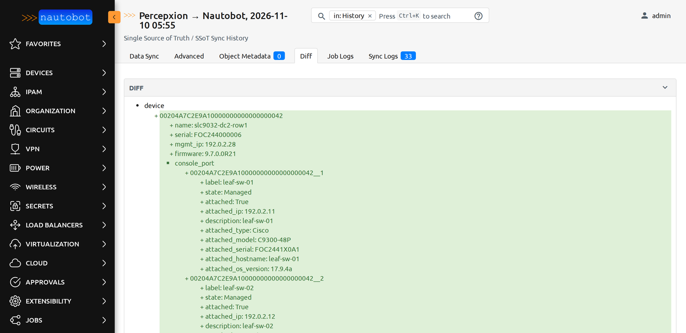
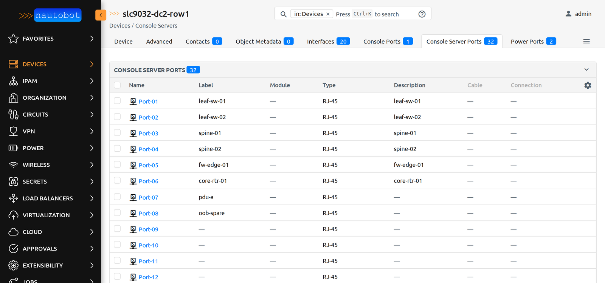
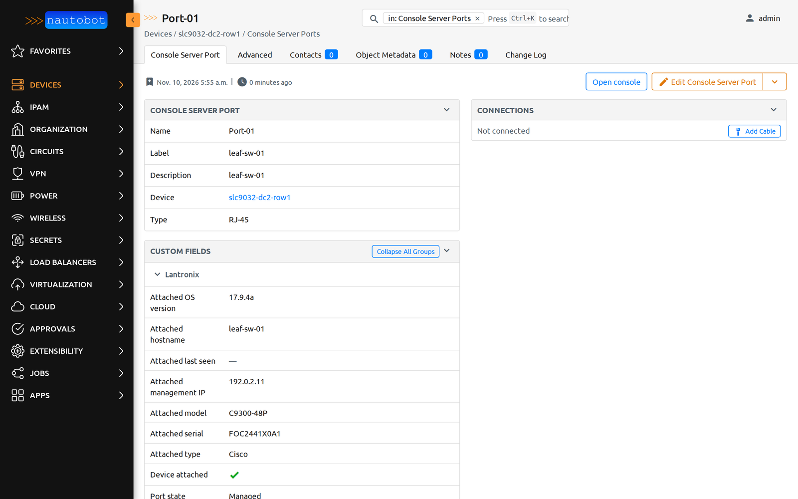

# nautobot-app-ssot-lantronix

A [Nautobot SSoT](https://github.com/nautobot/nautobot-app-ssot) integration that keeps Nautobot current with the Lantronix SLC 9000, SLC 8000 and EMG console servers managed by Percepxion. Nobody has to type console server inventory into Nautobot by hand.

The **Percepxion to Nautobot** job reads Percepxion and:

- creates each console server in Nautobot with the right device type, so its console server ports come from the device type
- labels each console server port with the name configured on the console server, and describes it with the hostname of the attached device
- records the port state and the attached device's type, model, OS version, serial, hostname and management IP in custom fields on the port, when the console server reports them
- adds an **Open console** link on each port that launches an SSH session through the console server (`ssh://<console server>:<base port + port number>`)

The job never writes to Percepxion or to a console server, and never deletes anything in Nautobot. Like every SSoT job, it can run as a dry run that shows the diff without writing.

Two optional modules build on the synced data:

- **ServiceNow console paths**: the stock nautobot-ssot ServiceNow job plus a "Connects to" relationship between each attached device and the console server port that reaches it.
- **Golden Config**: a Nornir dispatcher that backs up SLC configuration with every secret masked, for Nautobot Golden Config backup, intended and compliance jobs.







## Requirements

| | |
|---|---|
| Nautobot | 3.1 or later, below 4.0 |
| nautobot-ssot | 4.8 or later, below 5 |
| Python | 3.11 to 3.14 |
| Percepxion | Percepxion cloud or on-premises, and a Percepxion user with the **tenant_user** role in the organization you sync. No administrator role is needed. |
| Device types | Lantronix SLC and EMG device types, imported before the first sync. The definitions are in [`docker/device-types`](docker/device-types). |

### Compatibility

| nautobot-app-ssot-lantronix | Nautobot | nautobot-ssot | Python |
|---|---|---|---|
| 0.3.0 and later | 3.1 and later 3.x | 4.8 and later 4.x | 3.11 to 3.14 |
| 0.1.0 to 0.2.0 | 3.1 and later 3.x | 4.8 and later 4.x | 3.10 to 3.14 |

CI runs the tests against Nautobot 3.1 and 3.2. Beyond nautobot-ssot, the core sync needs no other app or service. The optional ServiceNow module needs `nautobot-ssot[servicenow]`, and the optional Golden Config module needs Nautobot Golden Config and a Netmiko release that includes the `lantronix_itmgos` driver.

## Install

1. Install the package into the Nautobot environment:

   ```
   pip install nautobot-app-ssot-lantronix
   ```

   To pin a version, install `nautobot-app-ssot-lantronix==X.Y.Z` with a version from the [releases](https://github.com/Lantronix/nautobot-app-ssot-lantronix/releases). For the ServiceNow module, install `"nautobot-app-ssot-lantronix[servicenow]"`. For a Docker install, follow [Docker](#docker) instead of these steps.

2. Enable and configure the app in `nautobot_config.py` (see [Configuration](#configuration)).

3. Run `nautobot-server post_upgrade` and restart Nautobot and its Celery worker.

4. Import the device types for your hardware from [`docker/device-types`](docker/device-types) with **Devices > Device Types > Import**, and create the location set as `default_location`.

5. Run the job (see [First sync](#first-sync)).

On the first run the app creates the manufacturer `Lantronix`, the platform `Lantronix ITM OS` (network driver `lantronix_itmgos`), the device role you configure, the custom fields it writes and the **Lantronix: Open console** custom link, and reuses any that already exist.

## Docker

This runs Nautobot 3.2 with nautobot-ssot and the app in Docker, including its database and Redis. You need Docker with Compose and a Percepxion user with the **tenant_user** role.

1. Clone the repository and create your settings file:

   ```
   git clone https://github.com/Lantronix/nautobot-app-ssot-lantronix.git
   cd nautobot-app-ssot-lantronix/docker
   cp env.example .env
   ```

2. Fill in every value in `.env`. Generate the secret key and passwords with `openssl rand -hex 32`, and the API token with `openssl rand -hex 20`.

3. Build and start Nautobot. The first start runs the database migrations and can take several minutes.

   ```
   docker compose up -d --build
   ```

4. Import the device types and create the **Console Servers** location. Running this again changes nothing that already exists.

   ```
   docker compose exec nautobot nautobot-server nbshell --command "exec(open('/opt/nautobot-lantronix/setup.py').read())"
   ```

5. Open http://localhost:8080, sign in as `admin` with `NAUTOBOT_SUPERUSER_PASSWORD`, and follow [First sync](#first-sync).

To use another port, set `NAUTOBOT_PORT` in `.env`. The stack runs as Compose project `nautobot-lantronix`, so its containers and database stay separate from any other Nautobot on the host.

## First sync

1. Go to **Jobs > Jobs**, edit **Percepxion to Nautobot** and enable it.
2. Run it with **Dryrun** on to see the diff without writing anything.
3. Run it again with **Dryrun** off.

## Configuration

The Percepxion endpoint, organization and credentials come only from environment variables. They're never stored in the Nautobot database, job inputs or logs.

| Variable | |
|---|---|
| `PERCEPXION_URL` | API base, for example `https://api.percepxion.ai/api`. Must use `https://`. |
| `PERCEPXION_USERNAME`, `PERCEPXION_PASSWORD` | The Percepxion user the job signs in as |
| `PERCEPXION_ORG_ID` | The Percepxion organization to sync |
| `PERCEPXION_CA_BUNDLE` | Optional CA bundle for on-premises Percepxion |

```python
PLUGINS = ["nautobot_ssot", "nautobot_ssot_lantronix"]

PLUGINS_CONFIG = {
    "nautobot_ssot": {"hide_example_jobs": True},
    "nautobot_ssot_lantronix": {
        "default_location": "Main Site",   # location for new console servers (must exist)
        "default_role": "Console Server",
        "default_status": "Active",
        "ssh_base_port": 3000,             # change if you changed it on your console servers
        "model_rules": {},                 # see Device models
        # "adoption_locations": ["Main Site"],  # where existing devices may be adopted
    },
}
```

A missing setting stops the job with an error that names the setting, never its value.

### Device models

Percepxion reports an SLC 9000's model as its total number of serial ports and doesn't report the Ethernet switch module or the power supply type, so several SLC 9000 SKUs look the same in Percepxion. The job picks the device type from `show sysconfig` output stored in Percepxion (if anyone has run `show sysconfig` on the unit through Percepxion, in the console editor or a CLI job), then from `model_rules`, then from a single device type that matches the port counts. A rule maps `MODEL|RJ45|USB` to a device type, for fleets that buy one variant:

```python
"model_rules": {"SLC9016|16|0": "lantronix-slc9016-16e"}
```

A device the job can't resolve isn't created; the job log names it and the candidate types. EMG units resolve from Percepxion data alone.

### What the job changes in Nautobot

| Object | Job writes | Job never changes |
|---|---|---|
| Console server (device) | created with name, type, location, role, platform, serial and the Percepxion device ID; management IP in a custom field, never in IPAM | location, role or type of an existing device |
| Console server port | label (the port's name on the console server), description (attached device hostname), port state and attached-device custom fields | name, cables, anything else |

The console server is the source of truth for port labels and descriptions. A label edited by hand in Nautobot is overwritten on the next sync; rename the port on the console server instead. An existing Nautobot device is adopted only when it's a Lantronix device on the Lantronix platform (or none) whose serial matches, or that has no serial and the same name; anything else with the same name is reported and left alone. Adoption links the device and renames it to its Percepxion name, with no approval step, and the job log records the old name.

Adoption is limited to devices in `default_location` or a location under it. To adopt elsewhere, list the location names in `adoption_locations`, or set `["*"]` for any location. A matching device outside those locations is reported in the job log and left alone. Each name must match exactly one location; if two locations share a name, no device is adopted under that name until you rename one. Tenants aren't checked, so keep `adoption_locations` to locations whose devices this Percepxion organization should manage.

### Who can run the job

Anyone with permission to run **Percepxion to Nautobot** creates and updates console servers and their ports through it, whatever their own object permissions on devices. That is how Nautobot SSoT jobs work. Grant the run permission for this job only to people who should manage that inventory.

The job has a soft time limit of 2 hours and a hard limit 5 minutes later. Change either on the job's edit page under **Jobs > Jobs**.

## Open console

The link builds `ssh://<address>:<SSH base port + port number>` from the device's primary IP, or the management address Percepxion reports. Your browser opens it with your SSH client and you sign in to the console server as yourself.

On the console server, direct SSH access is off by default on every port. Turn it on for the ports you want to reach, for example `set deviceport port 1-48 sshin enable` (answer `yes` to the confirmation).

## ServiceNow console paths (optional)

With nautobot-ssot's ServiceNow integration enabled (`"enable_servicenow": True` under `nautobot_ssot`, with its instance and credential settings), the app registers **Nautobot ⟹ ServiceNow (with console paths)**. It runs the stock device, interface, model and location sync, then adds a `cmdb_rel_ci` "Connects to::Connected by" relationship from each attached device to its console server, with the port number. Both CIs must already be in ServiceNow. The job never deletes records; links in ServiceNow with no Nautobot cable behind them are logged.

Set `"servicenow_console_link_parent": "console_server"` under `nautobot_ssot_lantronix` to make the console server the parent of each link instead.

## Golden Config (optional)

With Nautobot Golden Config installed, map the platform's network driver to the app's dispatcher:

```python
PLUGINS_CONFIG["nautobot_plugin_nornir"] = {
    "dispatcher_mapping": {
        "lantronix_itmgos": "nautobot_ssot_lantronix.golden_config.dispatcher.NetmikoLantronixItmgos",
    },
}
```

Backups use the console server's own configuration export and need a Netmiko release that includes the `lantronix_itmgos` driver. The dispatcher replaces the secrets it recognizes with `<secret hidden>`: prompted passwords, phrases and keys, SNMP communities, and local user password hashes. A backup whose prompted secrets can't be confirmed masked is refused, not saved. The dispatcher doesn't recognize every secret format a firmware release might add, so check a backup from each firmware version before you widen access to the backup repository.

## Troubleshooting

| Symptom | Check |
|---|---|
| Job isn't listed or can't run | **Jobs > Jobs**: enable **Percepxion to Nautobot** after installing or upgrading the app |
| Job stays pending | The Celery worker isn't running |
| Job shows **Failed** and you need the reason | The **Sync failed** line in the job result's log, or the `nautobot_ssot_lantronix.sync` line in the worker log (`docker compose logs worker`). The job result's traceback has the full detail. |
| Job fails with a login error | `PERCEPXION_USERNAME` and `PERCEPXION_PASSWORD`. Fix them and restart Nautobot and the worker. |
| Job fails with "was redirected" | `PERCEPXION_URL` answers with a redirect. The job never follows redirects; use the final address. |
| Job is stopped partway on a large fleet | The job's time limit. Raise it on the job's edit page. |
| An existing device isn't adopted | It's outside `adoption_locations`, or the job log gives another reason |
| Job fails with "Percepxion read failed" and an HTTP status | The account needs the **tenant_user** role in `PERCEPXION_ORG_ID`. Check the organization ID matches the one in Percepxion. |
| Device missing after a sync | The job log names each skipped device and why: ambiguous model, device type not imported, a duplicate name, or a conflict with an existing Nautobot device. Devices outside the configured organization are counted, not named. |

## Support

- Bugs and feature requests: [GitHub Issues](https://github.com/Lantronix/nautobot-app-ssot-lantronix/issues). Include the app, Nautobot and nautobot-ssot versions, and the job log.
- Questions about Percepxion or Lantronix console servers: [Lantronix Technical Support](https://www.lantronix.com/technical-support/).

## License

Apache-2.0
